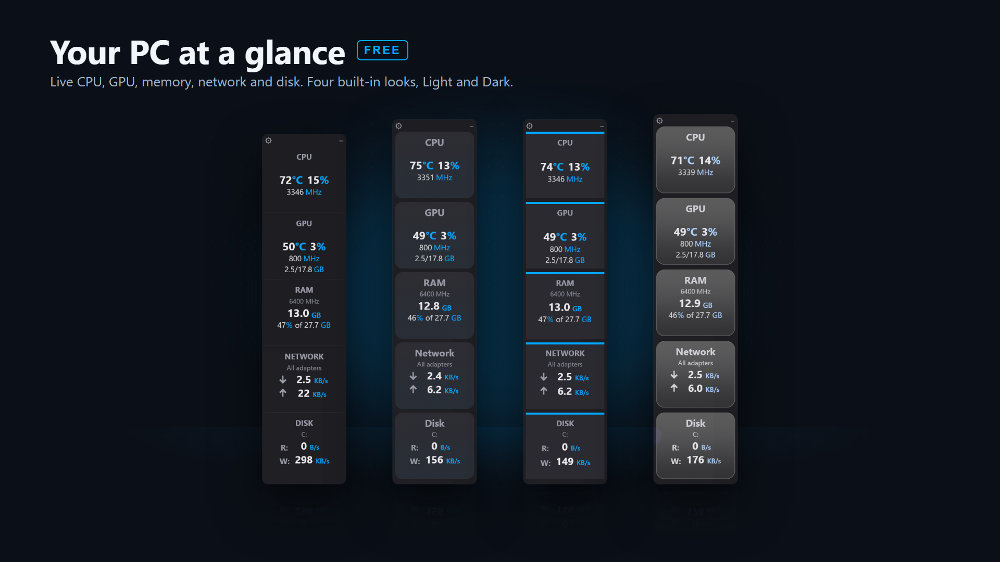
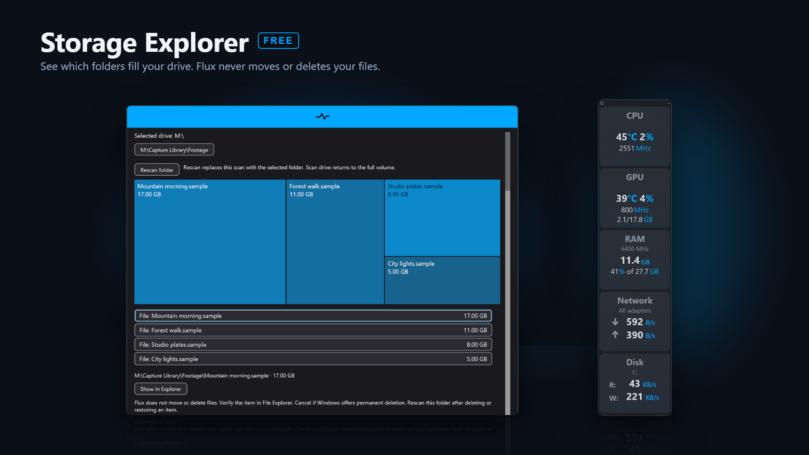
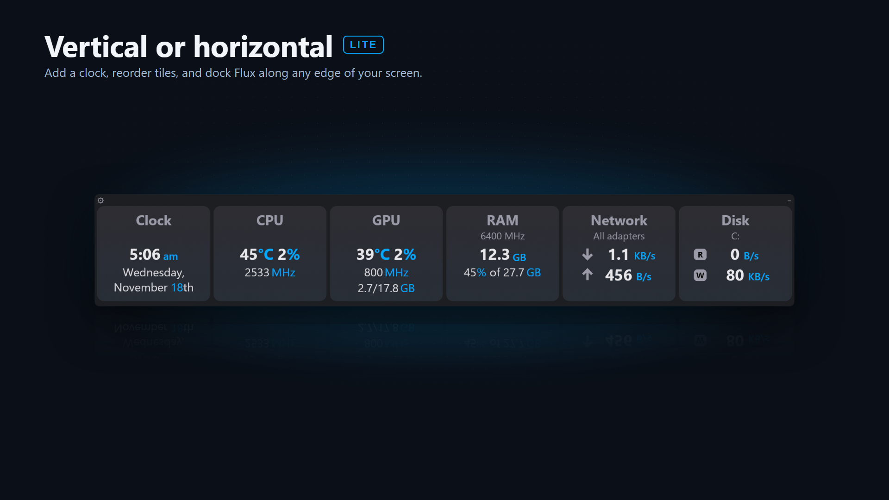
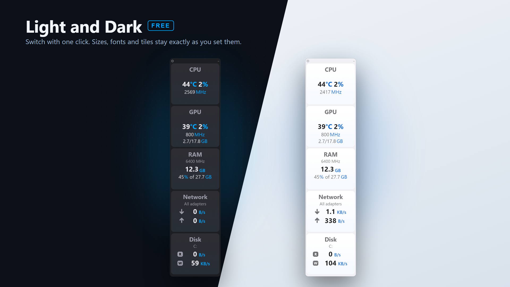
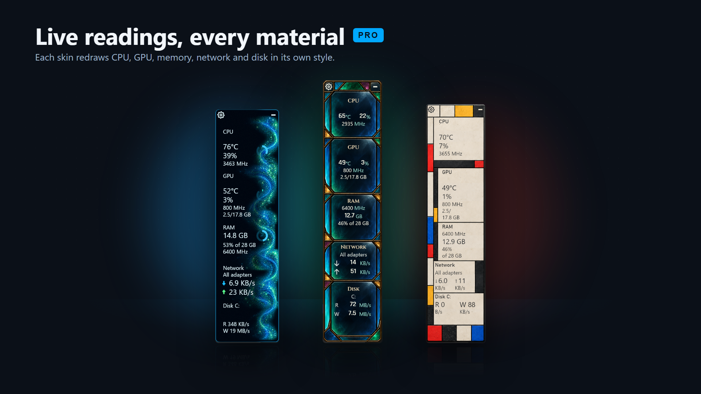
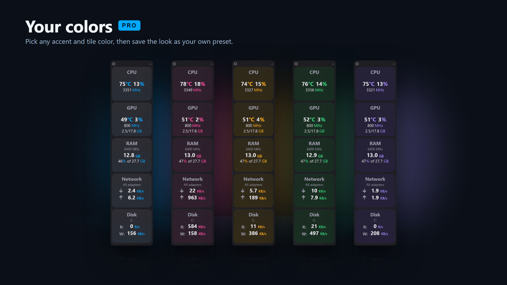
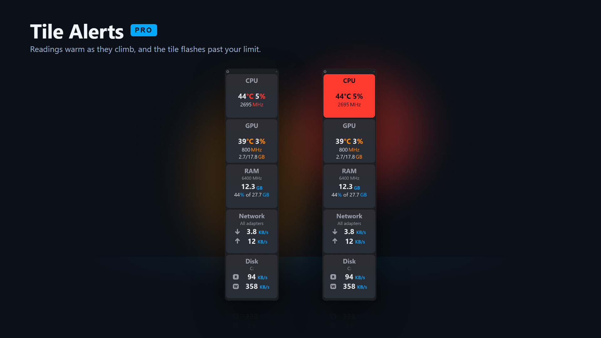
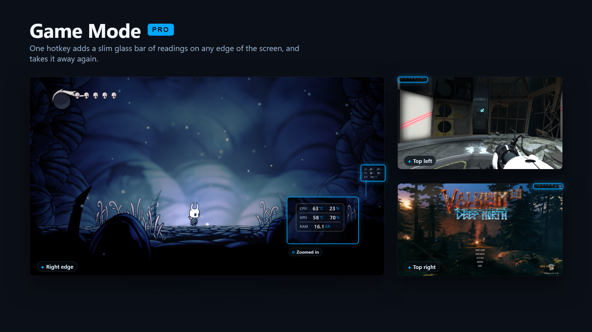
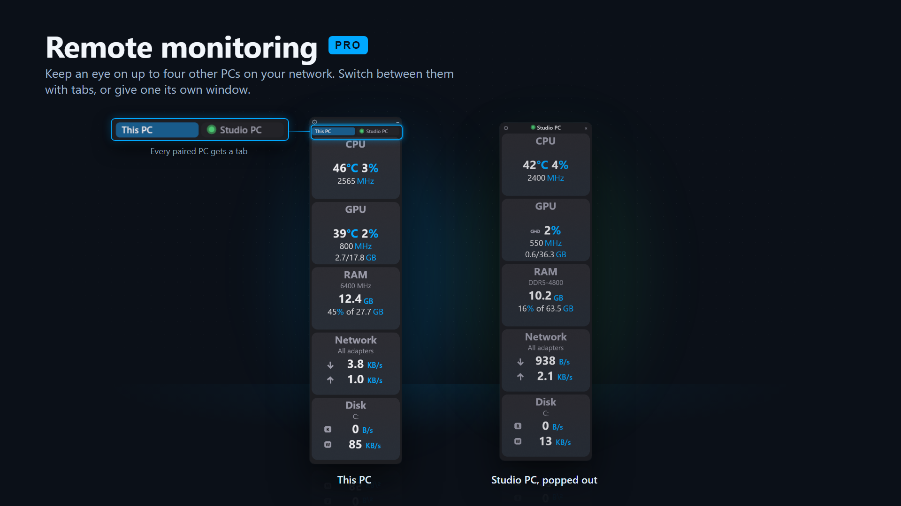

# Flux Monitor

**See how your PC is running without leaving what you're doing.**
Flux Monitor keeps live CPU, GPU, memory, network and disk readings in a compact
desktop widget, and Storage Explorer shows which folders fill your drives.

[](https://github.com/matthew-hakes/FluxMonitor/releases/tag/v1.3.11)
[](https://www.virustotal.com/gui/file/d50fa1a9e83ccf3d40e04824acd03cbe327b33540d3131a99df9b7e715d96a45)


This repository provides downloads and documentation. The application source is private.

## Screenshots

### Free

<table>
  <tr>
    <td width="50%" valign="top"><a href="docs/images/at-a-glance.png"></a><br><b>Your PC at a glance.</b> Live CPU, GPU, memory, network and disk, in Light or Dark.</td>
    <td width="50%" valign="top"><a href="docs/images/storage-explorer.png"></a><br><b>Storage Explorer.</b> See which folders fill a drive. Flux never moves or deletes your files.</td>
  </tr>
  <tr>
    <td width="50%" valign="top"><a href="docs/images/horizontal.png"></a><br><b>Vertical or horizontal.</b> Add a clock, reorder tiles and dock Flux along any screen edge.</td>
    <td width="50%" valign="top"><a href="docs/images/light-dark.png"></a><br><b>Light and Dark.</b> Switch with one click. Sizes, fonts and tiles stay as you set them.</td>
  </tr>
</table>

### Pro (Microsoft Store)

<table>
  <tr>
    <td width="50%" valign="top"><a href="docs/images/pro-skins.png"></a><br><b>Hand-crafted skins.</b> Stained glass, porcelain, opal, a circuit board, brass instruments and more.</td>
    <td width="50%" valign="top"><a href="docs/images/pro-skin-detail.png"></a><br><b>Every material, live.</b> Each skin redraws the same readings in its own style.</td>
  </tr>
  <tr>
    <td width="50%" valign="top"><a href="docs/images/pro-colors.png"></a><br><b>Themes and colors.</b> Mix any of the 21 Classic themes with colors of your own, then save the look.</td>
    <td width="50%" valign="top"><a href="docs/images/pro-alerts.png"></a><br><b>Tile Alerts.</b> Readings warm as they climb, and the tile flashes past your limit.</td>
  </tr>
  <tr>
    <td width="50%" valign="top"><a href="docs/images/pro-game-mode.png"></a><br><b>Game Mode.</b> One hotkey adds a slim, see-through overlay on any screen edge.</td>
    <td width="50%" valign="top"><a href="docs/images/pro-remote.png"></a><br><b>Remote monitoring.</b> Watch up to four other PCs on your network, in tabs or their own windows.</td>
  </tr>
</table>

## Release status

The latest Windows download is the standalone Free **v1.3.11**. See its
[release notes](https://github.com/matthew-hakes/FluxMonitor/releases/tag/v1.3.11)
for what changed. The Microsoft Store edition and its Pro upgrade are in private
beta and are not publicly available yet.

The macOS release stays on
[v1.3.0](https://github.com/matthew-hakes/FluxMonitor/releases/tag/v1.3.0).

<a id="free-and-pro"></a>

## Editions

Windows has two feature tiers, Free and Pro. Standalone Free and Store Free share
the same features; they differ only in how they are installed and updated.

| Feature | Standalone Free | Store Free | Store Pro |
| --- | :---: | :---: | :---: |
| Live CPU, GPU, RAM, Network, Disk and Clock tiles | ✓ | ✓ | ✓ |
| Storage Explorer | ✓ | ✓ | ✓ |
| Light and Dark, built-in skins, fonts, layout and opacity | ✓ | ✓ | ✓ |
| Optional sharing of this PC's readings on your local network | ✓ | ✓ | ✓ |
| Hand-crafted material skins | — | — | ✓ |
| Custom colors, theme palettes and saved appearances | — | — | ✓ |
| Tile Alerts | — | — | ✓ |
| Game Mode overlay | — | — | ✓ |
| Remote viewing of up to four other PCs, with pop-out windows | — | — | ✓ |

Pro is a one-time, non-expiring add-on purchased inside the Microsoft Store app.
It is not a subscription or a separate installer. Purchase and restore use the
Microsoft account that owns the app. Standalone Free does not accept Store
licenses or activation codes.

Beta licenses apply to the beta product; do not assume they transfer to a future
production app. Pricing and availability will be announced with the public release.

Standalone updates use this GitHub release channel. Store installations update
through the Microsoft Store and show a changelog in Settings instead.

### Remote monitoring

Sharing this PC's readings is optional, off by default and available in Free.
Viewing other PCs requires Pro. Add a PC by its address and pair it with a
one-time code shown on that PC (or with its handshake key, which can be switched
off). There is no automatic discovery. Connections use TLS with certificate
pinning, and each paired viewer has its own key that can be removed at any time.
Turn on sharing only on a trusted local network, and only for computers you are
authorized to monitor.

## Install

### Windows

1. Download `flux-setup-free-v1.3.11.exe` and its `.sha256` file from the
   [v1.3.11 release](https://github.com/matthew-hakes/FluxMonitor/releases/tag/v1.3.11).
2. Check that the file matches the published checksum:

   ```powershell
   Get-FileHash .\flux-setup-free-v1.3.11.exe -Algorithm SHA256
   ```

   - SHA-256: `D50FA1A9E83CCF3D40E04824ACD03CBE327B33540D3131A99DF9B7E715D96A45`
   - VirusTotal: **0 / 70**, [view the scan](https://www.virustotal.com/gui/file/d50fa1a9e83ccf3d40e04824acd03cbe327b33540d3131a99df9b7e715d96a45)

3. Run the installer.

The standalone installer is not code-signed, so SmartScreen may warn about it
(choose **More info**, then **Run anyway**). A matching checksum confirms the file
was not changed; it does not identify a trusted publisher or guarantee safety.
Download only from this repository's release page, and never install a
certificate to trust a Flux build.

WinGet distribution is planned but not yet confirmed. Use the GitHub download for now.

### macOS v1.3.0

1. Download `Flux-Monitor-Free-v1.3.0-macOS-arm64.dmg` and its `.sha256` file from the
   [v1.3.0 release](https://github.com/matthew-hakes/FluxMonitor/releases/tag/v1.3.0).
2. Verify the disk image:

   ```bash
   shasum -a 256 ~/Downloads/Flux-Monitor-Free-v1.3.0-macOS-arm64.dmg
   ```

3. Open the disk image and drag **Flux** to **Applications**.

The Mac app is ad-hoc signed, not Apple-notarized. See the release notes for
installation and sensor details.

### Requirements

- Windows 10 or 11, x64, with a compatible graphics driver.
- macOS 12 or later on Apple Silicon (arm64) for the Mac release.

Readings depend on the device, firmware, drivers and permissions. Check Windows
Server compatibility for your specific release and system.

## CPU temperature on Windows

CPU temperature uses the optional third-party
[PawnIO](https://pawnio.eu/) driver. Usage and clock readings work without it.

- **Standalone:** tick the PawnIO option in setup, use **Temp: set up** on the CPU
  tile later, or add `--with-cpu-temp` to a silent install. Flux runs the official,
  unmodified PawnIO installer it ships with, after checking it, and Windows asks
  for administrator approval.
- **Microsoft Store:** the widget, local network features and purchases run with
  normal user rights. Temperature setup asks for administrator approval when you
  use it. The Store edition adds no permanent sensor task or service.

PawnIO installs its own shared driver, and uninstalling Flux does not remove it.
Not every processor or motherboard reports temperatures.

## Privacy and support

See the [privacy policy](PRIVACY.md) for how data is handled and how to get in touch.
Report problems through [Issues](https://github.com/matthew-hakes/FluxMonitor/issues).
Never post handshake keys, pairing codes, credentials or other private information
in a report.

## Uninstall

### Windows

Open Windows **Settings**, go to **Apps**, find **Flux** and choose **Uninstall**.
Review the options your installed version shows before removing settings or
optional components.

### macOS v1.3.0

Quit Flux from the Flux Drop, then move `Flux.app` from Applications to the Trash.
To remove preferences too, delete `~/Library/Application Support/com.Flux.Flux`,
and remove `~/Library/LaunchAgents/com.matthewhakes.flux.plist` if startup was enabled.

## License

© 2026 Matthew Hakes. Flux Monitor is proprietary software, licensed, not sold,
under the End User License Agreement in [`LICENSE`](LICENSE) (v2.3, November 17, 2026).
Free permits personal and internal business use, including monitoring servers
(for example Windows Server) you own or are authorized to manage. On Windows, Pro
features are unlocked only through the Microsoft Store. Organizations may deploy
the unmodified standalone Free installer internally; public redistribution or
mirroring requires prior written permission. The license does not promise
compatibility with any particular system.

Flux is provided as is, to the extent the law allows. Hardware readings can be
wrong and must not be relied on for safety. The terms are governed by Tennessee
law, subject to the mandatory consumer law where you live. Third-party components
keep their own licenses. Each release states the license and privacy terms that
apply to it.

The Microsoft Store edition is licensed under Microsoft's standard application
license terms instead; the `LICENSE` file here governs the standalone downloads
(GitHub and WinGet).
